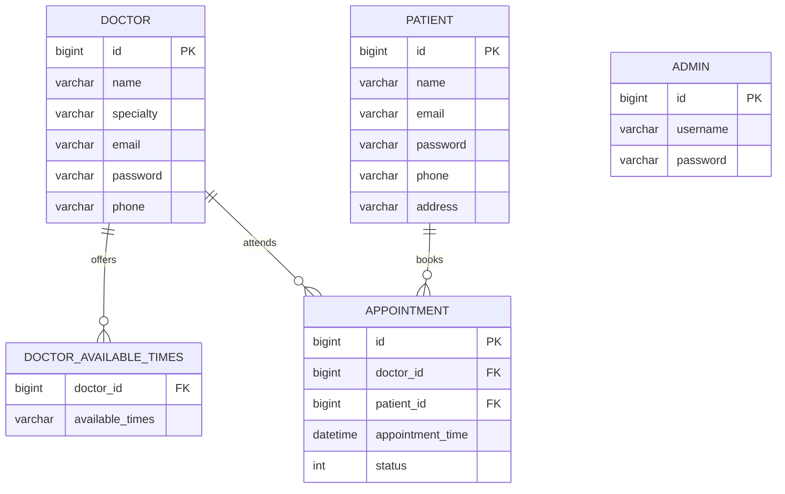

# Schema Design — Smart Clinic Management System

The Smart Clinic stores its data in two databases:

- **MySQL** holds the structured, validated and interrelated operational data: admins, doctors, doctors' time slots, patients and appointments.
- **MongoDB** holds data whose shape is flexible: prescriptions with free-text notes and optional fields.

The tables below are the ones defined by the Spring Boot back end's JPA entities (Hibernate creates them on first start with `ddl-auto=update`), and the sample data in `sql/sample-data.sql` and the stored procedures in `sql/stored-procedures.sql` use the same names.

## MySQL Database Design

Database name: `cms`

### Relationships



### Table: admin
Accounts that manage the platform (add and delete doctors).
- id: BIGINT, Primary Key, Auto Increment
- username: VARCHAR(255), Not Null — the login name
- password: VARCHAR(255), Not Null

### Table: doctor
- id: BIGINT, Primary Key, Auto Increment
- name: VARCHAR(100), Not Null (3–100 characters)
- specialty: VARCHAR(50), Not Null (3–50 characters)
- email: VARCHAR(255), Not Null — must be a valid email; must be unique (see "Where rules are enforced")
- password: VARCHAR(255), Not Null (at least 6 characters)
- phone: VARCHAR(255), Not Null — exactly 10 digits

### Table: doctor_available_times
One row per time slot a doctor offers, for example `09:00-10:00`.
- doctor_id: BIGINT, Not Null, Foreign Key → doctor(id)
- available_times: VARCHAR(255) — the slot, written as `HH:mm-HH:mm`

### Table: patient
- id: BIGINT, Primary Key, Auto Increment
- name: VARCHAR(100), Not Null (3–100 characters)
- email: VARCHAR(255), Not Null — must be a valid email; must be unique
- password: VARCHAR(255), Not Null (at least 6 characters)
- phone: VARCHAR(255), Not Null — exactly 10 digits; must be unique
- address: VARCHAR(255), Not Null

### Table: appointment
- id: BIGINT, Primary Key, Auto Increment
- doctor_id: BIGINT, Not Null, Foreign Key → doctor(id)
- patient_id: BIGINT, Not Null, Foreign Key → patient(id)
- appointment_time: DATETIME(6) — start of the one-hour appointment; must be in the future when it is booked
- status: INT, Not Null (0 = Scheduled, 1 = Completed)

The end of an appointment is not stored; it is always `appointment_time + 1 hour`.

### Where rules are enforced

| Rule | Enforced by |
|------|-------------|
| Required fields, maximum lengths | Bean Validation in the models, and `NOT NULL` / `VARCHAR(n)` in the generated tables |
| Valid email, 10-digit phone, password of at least 6 characters | Bean Validation (`@Email`, `@Pattern`, `@Size`) before anything is saved |
| Email unique for doctors and patients, phone unique for patients | The service layer checks before saving (a database `UNIQUE` constraint is a recommended hardening step) |
| Appointment time in the future | `@Future` when an appointment is booked or changed |
| A doctor cannot be double-booked | `validateAppointment` accepts only a start time that is one of the doctor's slots and has no appointment yet |
| Appointments always point at a real doctor and patient | Foreign keys |

### Design decisions

**What happens if a patient is deleted? Should appointments go too?**
The foreign key has no `ON DELETE CASCADE`, so MySQL refuses to delete a patient who still has appointments. That protects appointment history. The application never deletes patients today; if that is ever needed, the patient record should be anonymised rather than removed so completed appointments stay valid.

**What happens if a doctor is deleted?**
The admin's "Delete" action removes the doctor's appointments first and then the doctor, in one transaction, so either everything is deleted or nothing is. The doctor's time slots are removed together with the doctor.

**Should a doctor be allowed to have overlapping appointments?**
No. A slot can be booked only when the doctor offers it and no appointment exists at that start time, and the add-doctor form only offers whole-hour slots, so two appointments cannot overlap. A `UNIQUE (doctor_id, appointment_time)` constraint would make the same guarantee in the database itself.

**Should each doctor have their own available time slots?**
Yes. Slots live in `doctor_available_times`, one row per slot, rather than in a comma-separated string. That keeps "available in the morning" (AM/PM) and "available at exactly 09:00-10:00" simple to filter, and lets a doctor's slots change without touching the doctor row.

**Should a patient's appointment history be kept forever?**
Yes. Completed appointments stay with `status = 1`. The reporting procedures (busiest doctor of a month or year, daily report) read this history.

**Is a prescription tied to an appointment, or can it exist alone?**
It is tied to one: every prescription stores the `appointmentId` it was issued for, and only one prescription is allowed per appointment. See the MongoDB section.

### Not in the current schema

`clinic_locations` and `payments` tables were considered and left out: the clinic is a single location and the portal does not take payments. They would be added as new tables with a foreign key to `appointment` when needed.

## MongoDB Collection Design

Database name: `prescriptions`

### Why MongoDB for prescriptions

A prescription is a small, self-contained document whose content varies: some have long doctor's notes, some have none, and a clinic may later want refill counts, pharmacy details or attachments. A document store lets those fields appear without altering a table. The same flexibility suits other data that would be awkward as rigid tables: free-form doctor notes, optional patient feedback, file attachments, and logs or chat messages.

### Collection: prescriptions

Example document:

```json
{
  "_id": { "$oid": "6807dd712725f013281e7201" },
  "patientName": "John Smith",
  "appointmentId": 51,
  "medication": "Paracetamol",
  "dosage": "500mg",
  "doctorNotes": "Take 1 tablet every 6 hours."
}
```

| Field | Type | Required | Notes |
|-------|------|----------|-------|
| _id | ObjectId | generated | Primary key of the document |
| patientName | string | yes | 3–100 characters; kept so a prescription can be shown without another lookup |
| appointmentId | number | yes | Points at `appointment.id` in MySQL |
| medication | string | yes | 3–100 characters |
| dosage | string | yes | 3–100 characters; free text such as "500mg" or "1 tablet twice a day" |
| doctorNotes | string | no | Up to 200 characters |

### Because the schema is flexible

New fields can be added to new documents without migrating the old ones, for example:

```json
{
  "_id": { "$oid": "6807dd712725f013281e7202" },
  "patientName": "Emily Rose",
  "appointmentId": 52,
  "medication": "Aspirin",
  "dosage": "300mg",
  "doctorNotes": "Take 1 tablet after meals.",
  "refillCount": 2,
  "tags": ["pain", "short-term"],
  "pharmacy": { "name": "Walgreens SF", "location": "Market Street" }
}
```

### Design decisions

**Should a document hold the full patient object or just an ID?**
Neither extreme: it holds the patient's name for display and the `appointmentId` as the link. The patient's contact details stay in MySQL, which remains the single source of truth, so nothing has to be updated in two places when a phone number changes.

**How is the link to MySQL kept valid?**
MongoDB cannot enforce a foreign key into MySQL, so the application does it: a prescription is only saved by a logged-in doctor, only one prescription per appointment is accepted, and saving it marks the appointment as completed.

**What would a chat message look like?**
A future `messages` collection could hold documents such as:

```json
{
  "appointmentId": 51,
  "from": "patient",
  "text": "Should I take it with food?",
  "sentAt": { "$date": "2025-05-02T09:30:00Z" },
  "attachments": []
}
```

**What if the schema needs to evolve?**
Old and new documents can sit side by side in the same collection. The application treats the extra fields as optional, so a rollout never needs downtime or a data migration.
